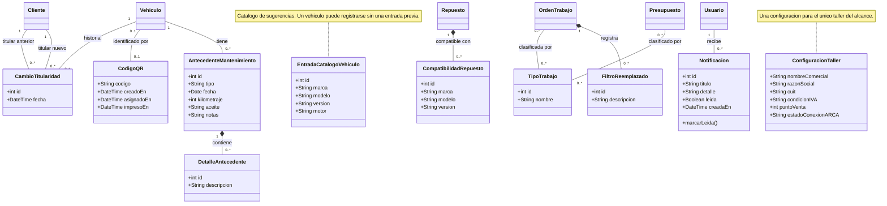

# Diagrama de clases UML — Octano

Modelo de dominio propuesto a partir del modelo de datos del taller. Los métodos representan responsabilidades propuestas para las clases; todavía no son una implementación orientada a objetos del frontend.

Se muestran las clases principales del recorrido cliente → vehículo → turno/presupuesto → orden → comprobante → cobro. Las asociaciones representan referencias entre objetos, por eso no se repiten claves foráneas como atributos.

```mermaid
classDiagram
    direction LR

    class Cliente {
        +int id
        +String nombre
        +String documento
        +String telefono
        +String email
        +Boolean activo
        +archivar()
    }
    class Vehiculo {
        +int id
        +String patente
        +String marca
        +String modelo
        +int anio
        +int kilometraje
        +cambiarTitular(Cliente nuevoTitular)
    }
    class Usuario {
        +int id
        +String nombre
        +String email
        +String rol
        +Boolean activo
    }
    class Puesto {
        +int id
        +int numero
        +String descripcion
        +Boolean activo
    }
    class Turno {
        +int id
        +DateTime inicioProgramado
        +DateTime finProgramado
        +String motivo
        +String estado
        +confirmar()
        +cancelar()
        +registrarIngreso()
    }
    class OrdenTrabajo {
        +int id
        +String descripcion
        +String estado
        +String diagnostico
        +DateTime ingreso
        +DateTime inicioTrabajo
        +DateTime finalizacion
        +DateTime entrega
        +int kilometrajeIngreso
        +Decimal importeManoObra
        +iniciar()
        +finalizar()
        +entregar()
        +cancelar()
        +calcularTotal() Decimal
    }
    class TareaOrden {
        +int id
        +String descripcion
        +Boolean completada
        +int posicion
        +completar()
    }
    class FotoOrden {
        +int id
        +String sector
        +String rutaArchivo
        +DateTime fecha
    }
    class Repuesto {
        +int id
        +String nombre
        +String marca
        +String codigoOEM
        +Decimal stockActual
        +Decimal stockMinimo
        +Decimal costo
        +Decimal precioVenta
        +Boolean archivado
        +requiereReposicion() Boolean
    }
    class DetalleOrden {
        +int id
        +String descripcion
        +Decimal cantidad
        +Decimal precioUnitario
        +String origen
        +String estadoStock
        +calcularSubtotal() Decimal
    }
    class Presupuesto {
        +int id
        +Date fecha
        +String descripcion
        +String estado
        +calcularTotal() Decimal
    }
    class DetallePresupuesto {
        +int id
        +String tipo
        +String descripcion
        +Decimal cantidad
        +Decimal precioUnitario
        +Decimal alicuotaIVA
        +calcularSubtotal() Decimal
    }
    class Comprobante {
        +int id
        +Date fecha
        +String tipo
        +String estadoEmision
        +Boolean esFiscal
        +String cae
        +Decimal neto
        +Decimal iva
        +Decimal total
        +estaCobrado() Boolean
    }
    class DetalleComprobante {
        +int id
        +String descripcion
        +Decimal cantidad
        +Decimal precioUnitario
        +Decimal alicuotaIVA
        +Decimal importeTotal
    }
    class Cobro {
        +int id
        +DateTime fecha
        +Decimal importe
        +String medioPago
        +String observaciones
    }

    Cliente "1" -- "0..*" Vehiculo : titular actual
    Cliente "1" -- "0..*" Presupuesto : solicita
    Cliente "1" -- "0..*" OrdenTrabajo : solicita
    Vehiculo "1" -- "0..*" Turno : tiene
    Vehiculo "1" -- "0..*" Presupuesto : recibe
    Vehiculo "1" -- "0..*" OrdenTrabajo : recibe
    Presupuesto "0..1" -- "0..*" Turno : origina
    Turno "0..1" -- "0..1" OrdenTrabajo : genera
    Presupuesto "0..1" -- "0..*" OrdenTrabajo : respalda
    Usuario "0..1" -- "0..*" OrdenTrabajo : mecanico asignado
    Puesto "0..1" -- "0..*" OrdenTrabajo : asignado a lo largo del tiempo
    OrdenTrabajo "1" *-- "0..*" TareaOrden : tareas
    OrdenTrabajo "1" *-- "0..6" FotoOrden : fotos
    OrdenTrabajo "1" *-- "0..*" DetalleOrden : repuestos e insumos
    Repuesto "0..1" -- "0..*" DetalleOrden : referencia
    Presupuesto "1" *-- "0..*" DetallePresupuesto : renglones
    Repuesto "0..1" -- "0..*" DetallePresupuesto : referencia
    OrdenTrabajo "0..1" -- "0..1" Comprobante : origina
    Cliente "1" -- "0..*" Comprobante : receptor
    Vehiculo "1" -- "0..*" Comprobante : corresponde a
    Comprobante "1" *-- "0..*" DetalleComprobante : renglones
    Comprobante "1" -- "0..1" Cobro : registra

    note for Usuario "Roles: DUENO o MECANICO. Solo un mecanico activo puede ser asignado a una orden."
    note for Presupuesto "Puede conservar turnos y ordenes canceladas. Maximo un turno vigente y una orden no cancelada."
    note for Comprobante "Puede existir sin orden por datos historicos. Al emitirse requiere renglones y conserva los datos del emisor y receptor."
```

## Cómo leerlo

- `+` indica un atributo o una operación públicos en este modelo de análisis.
- `1`: exactamente uno. `0..1`: opcional, como máximo uno. `0..*`: cero o muchos.
- El rombo negro (`*--`) representa composición: los detalles, tareas y fotos pertenecen a su documento u orden. No implica borrar documentos históricos en cascada.
- Una línea simple representa asociación; por ejemplo, un repuesto existe independientemente de la orden que lo usa.
- Un cliente es una entidad del negocio. Un usuario es una persona con acceso al sistema; no se presupone que los clientes tengan cuenta.

## Restricciones del dominio

- La orden conserva al cliente solicitante aunque el vehículo cambie de titular.
- La creación del turno genera una orden pendiente de ingreso; el vínculo es opcional para admitir órdenes sin turno y estados intermedios de creación.
- Los puestos se reutilizan entre trabajos, pero no pueden tener dos órdenes activas simultáneas. La multiplicidad muestra su historial, no la ocupación concurrente.
- Un detalle puede no referenciar un repuesto del catálogo cuando representa un insumo externo o un concepto libre. La mano de obra de la orden se suma una sola vez.
- El cobro es completo y único por comprobante en este alcance. No se incluyen pagos parciales.
- Las fechas reales de la orden pueden estar ausentes hasta que ocurra cada evento; el diagnóstico y los datos fiscales también pueden estar pendientes según el estado.
- Los importes y las cantidades fraccionarias usan Decimal. Los cálculos deben adoptar la misma convención de IVA y redondeo.
- Los renglones se componen con multiplicidad `0..*` para permitir borradores; un comprobante emitido debe tener al menos un renglón.

## Clases de apoyo

Separadas del diagrama principal para facilitar la lectura. Completan las funciones de la maqueta descritas en `modelo-de-datos.md`.

Las tablas intermedias ORDEN_TIPO_TRABAJO y PRESUPUESTO_TIPO_TRABAJO del modelo relacional se expresan aquí como asociaciones muchos a muchos: no necesitan clases propias mientras no tengan atributos adicionales.
