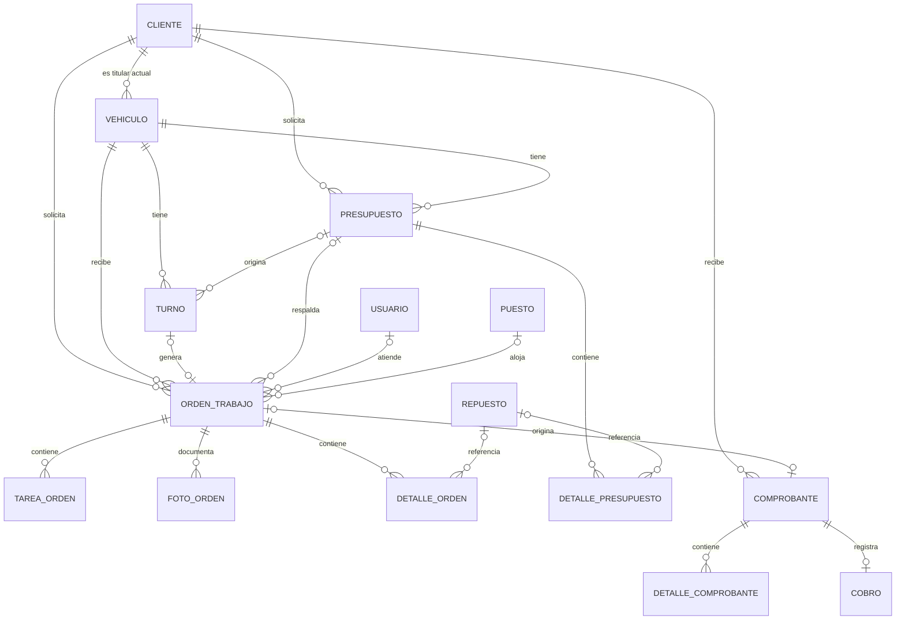

# Modelo de datos de Octano

Propuesta inicial de modelo lógico relacional para el sistema de gestión de taller mecánico. Basada en `app/types/index.ts`, `app/composables/useDatabase.ts`, `app/composables/useOwnerAccount.ts` y los flujos de turnos, órdenes y facturación.

La maqueta actual guarda objetos en localStorage. Este documento propone cómo organizarlos en una base de datos; no representa una base ya implementada ni modifica el funcionamiento de la aplicación.

## Alcance y supuestos

- Un solo taller, con un dueño y usuarios mecánicos. No se agregan sucursales ni múltiples empresas.
- Un vehículo tiene un titular actual y puede cambiar de titular.
- Cada orden corresponde a un vehículo y conserva el cliente que solicitó el trabajo.
- Cada orden tiene como máximo un mecánico y un puesto asignados, según la interfaz actual.
- Se puede crear una orden sin turno y sin presupuesto.
- Un turno genera como máximo una orden. La aplicación ya la genera al reservar, en estado «Pendiente de ingreso».
- Un presupuesto puede tener varios intentos de turno a lo largo del tiempo, pero solo un turno vigente y como máximo una orden no cancelada que lo ejecute. Esto permite cancelar y volver a reservar sin borrar antecedentes.
- Para el alcance actual, una orden tiene como máximo un comprobante y este se cobra completo en una sola operación. Pagos parciales y notas de crédito quedan fuera de esta versión.

## Relaciones principales

`1:N` significa «uno a muchos»; `0..1` indica que la relación es opcional y admite como máximo un registro.

La relación presupuesto–orden admite antecedentes cancelados; la restricción de una sola orden no cancelada se aplica adicionalmente al diagrama. Un comprobante sin orden permite conservar los ejemplos históricos de la maqueta.

## Diccionario de tablas

**PK:** clave primaria, identifica un registro. **FK:** clave foránea, apunta a otra tabla. **UQ:** valor único. **?:** campo opcional. Todos los campos sin `?` son obligatorios en la propuesta. Los identificadores son enteros generados por la base de datos.

### 1. CLIENTE

`id_cliente PK`, `nombre`, `tipo_documento`, `numero_documento`, `telefono`, `email?`, `direccion?`, `ciudad?`, `provincia?`, `condicion_iva`, `activo`.

Unicidad por `(tipo_documento, numero_documento)`, con documento normalizado. Los documentos se guardan como texto. El archivo lógico cambia `activo`; no elimina sus trabajos anteriores.

### 2. VEHICULO

`id_vehiculo PK`, `id_cliente_actual FK → CLIENTE`, `marca`, `modelo`, `version?`, `anio`, `motor`, `patente UQ`, `kilometraje_actual`, `color?`.

Patente normalizada en mayúsculas y sin separadores. Se mantiene marca/modelo como texto para permitir altas que no existan en el catálogo, igual que en la maqueta.

### 3. USUARIO

`id_usuario PK`, `nombre`, `email UQ`, `password_hash`, `rol`, `telefono?`, `activo`.

Roles iniciales: `DUENO`, `MECANICO`. En las órdenes se referencia al mecánico por su ID, en lugar de guardar su nombre como vínculo. Las credenciales se gestionan en el backend futuro.

### 4. PUESTO

`id_puesto PK`, `numero UQ`, `descripcion?`, `activo`.

Representa los puestos físicos del taller. La ocupación actual se obtiene de las órdenes activas asignadas; no se guarda otro campo de ocupación independiente.

### 5. TURNO

`id_turno PK`, `id_vehiculo FK → VEHICULO`, `id_presupuesto? FK → PRESUPUESTO`, `inicio_programado`, `fin_programado`, `motivo`, `estado`.

Estados actuales: `PROGRAMADO`, `CONFIRMADO`, `EN_TALLER`, `CANCELADO`, `NO_ASISTIO`. El fin debe ser posterior al inicio. Para migrar registros antiguos sin hora final se debe definir una duración antes de exigir este campo.

### 6. ORDEN_TRABAJO

`id_orden PK`, `id_vehiculo FK → VEHICULO`, `id_cliente FK → CLIENTE`, `id_turno? FK UQ → TURNO`, `id_presupuesto? FK → PRESUPUESTO`, `id_mecanico? FK → USUARIO`, `id_puesto? FK → PUESTO`, `descripcion`, `estado`, `creada_en`, `ingreso_en?`, `inicio_trabajo_en?`, `finalizada_en?`, `entregada_en?`, `kilometraje_ingreso?`, `diagnostico?`, `observaciones?`, `notas_mecanico?`, `motivo_cancelacion?`, `importe_mano_obra`, `aceite_especificacion?`, `aceite_del_cliente`.

Estados: `PENDIENTE_INGRESO`, `EN_ESPERA`, `EN_PROCESO`, `FINALIZADO`, `ENTREGADO`, `CANCELADO`. El cliente queda asociado al trabajo aunque luego cambie el titular del vehículo. Se distinguen las fechas programadas del turno de las fechas reales del trabajo.

### 7. TAREA_ORDEN

`id_tarea PK`, `id_orden FK → ORDEN_TRABAJO`, `descripcion`, `completada`, `posicion`.

Representa el checklist. El porcentaje de avance se calcula con las tareas completadas, según la regla que se adopte para órdenes sin tareas.

### 8. FOTO_ORDEN

`id_foto PK`, `id_orden FK → ORDEN_TRABAJO`, `sector`, `ruta_archivo`, `creada_en`.

La base guarda la referencia al archivo; el almacenamiento de imágenes queda separado. El máximo actual de seis fotos por orden se valida al cargarlas.

### 9. REPUESTO

`id_repuesto PK`, `nombre`, `marca`, `codigo_oem`, `stock_actual`, `stock_minimo`, `costo`, `precio_venta`, `archivado`.

El código OEM no se presupone único entre distintas marcas. El margen se puede calcular a partir del costo y el precio; si se quiere guardar una política de margen, debe distinguirse del margen calculado.

### 10. DETALLE_ORDEN

`id_detalle_orden PK`, `id_orden FK → ORDEN_TRABAJO`, `id_repuesto? FK → REPUESTO`, `descripcion`, `cantidad`, `precio_unitario`, `origen`, `estado_stock`.

Origen: `PRESUPUESTADO` o `ADICIONAL`. Estado de stock: `NO_APLICA`, `PENDIENTE`, `DESCONTADO` o `DEVUELTO`. La descripción y el precio se conservan como valores del trabajo. El repuesto es opcional para insumos externos o renglones libres; estos no modifican inventario. La mano de obra global se guarda en la orden y no se vuelve a sumar como repuesto.

### 11. PRESUPUESTO

`id_presupuesto PK`, `id_cliente FK → CLIENTE`, `id_vehiculo FK → VEHICULO`, `fecha`, `descripcion`, `estado`, `aceite_especificacion?`.

Los importes se obtienen de sus renglones. Durante la migración, los presupuestos antiguos que solo tengan importes agregados se convierten en renglones de mano de obra y materiales.

### 12. DETALLE_PRESUPUESTO

`id_detalle_presupuesto PK`, `id_presupuesto FK → PRESUPUESTO`, `id_repuesto? FK → REPUESTO`, `tipo`, `descripcion`, `cantidad`, `precio_unitario`, `alicuota_iva`, `posicion`.

Tipos: `REPUESTO`, `MANO_OBRA`, `OTRO`. El ID del repuesto es opcional porque la maqueta admite conceptos personalizados. Presupuestar no descuenta stock. Para cada renglón debe acordarse si el precio ingresado incluye IVA; esa misma convención se aplica en el cálculo y en su conversión a comprobante.

### 13. COMPROBANTE

`id_comprobante PK`, `id_orden? FK UQ → ORDEN_TRABAJO`, `id_cliente FK → CLIENTE`, `id_vehiculo FK → VEHICULO`, `fecha`, `tipo`, `estado_emision`, `es_fiscal`, `punto_venta?`, `numero?`, `cae?`, `vencimiento_cae?`, `emisor_snapshot`, `receptor_snapshot`, `neto`, `iva`, `total`.

Estado de emisión separado del cobro: `BORRADOR`, `EMITIDO`. El estado comercial «Cobrada» se obtiene de COBRO. Los snapshots conservan nombre, documento, condición de IVA y domicilio tal como figuraron al emitir; pueden ser columnas explícitas o documentos JSON en el diseño físico. Los campos fiscales reflejan los datos previstos en la maqueta y no constituyen una especificación de integración fiscal.

### 14. DETALLE_COMPROBANTE

`id_detalle_comprobante PK`, `id_comprobante FK → COMPROBANTE`, `descripcion`, `cantidad`, `precio_unitario`, `alicuota_iva`, `importe_neto`, `importe_iva`, `importe_total`, `posicion`.

Conserva los valores de emisión sin depender de cambios posteriores en repuestos, órdenes o presupuestos. Los totales de cabecera deben coincidir con la suma de los detalles usando una regla de redondeo definida.

### 15. COBRO

`id_cobro PK`, `id_comprobante FK UQ → COMPROBANTE`, `fecha`, `importe`, `medio_pago`, `observaciones?`.

El alcance inicial admite un cobro completo por comprobante. El importe debe coincidir con el total. La unicidad impide registrar dos veces el mismo cobro. Si después se habilitan anticipos o cuotas, esta relación pasa a 1:N y se incorpora el cálculo del saldo.

## Tablas de apoyo para las funciones actuales

| Tabla | Campos principales | Finalidad |
|---|---|---|
| HISTORIAL_TITULARIDAD | `id PK`, `id_vehiculo FK`, `id_cliente_anterior FK`, `id_cliente_nuevo FK`, `fecha_cambio` | Registrar cada transferencia; el alta inicial queda en VEHICULO. |
| CODIGO_QR | `codigo PK`, `id_vehiculo? FK UQ`, `creado_en`, `asignado_en?`, `impreso_en?` | Mantener códigos disponibles antes de asociarlos y como máximo uno por vehículo. El estado se deriva de la asignación. |
| CATALOGO_VEHICULO | `id_catalogo PK`, `marca`, `modelo`, `version?`, `motor` | Sugerencias del formulario. Unicidad por combinación normalizada. |
| COMPATIBILIDAD_REPUESTO | `id_compatibilidad PK`, `id_repuesto FK`, `marca`, `modelo`, `version?` | Un repuesto admite varios modelos. Versión vacía significa todas las versiones, como en el filtro actual; no afirma compatibilidad técnica fuera de la demo. |
| TIPO_TRABAJO | `id_tipo PK`, `nombre UQ` | Clasificar mantenimiento, distribución y otros trabajos. |
| ORDEN_TIPO_TRABAJO | `id_orden PK/FK`, `id_tipo PK/FK` | Resolver la relación N:M entre órdenes y tipos de trabajo. |
| PRESUPUESTO_TIPO_TRABAJO | `id_presupuesto PK/FK`, `id_tipo PK/FK` | Clasificar un presupuesto antes de generar su orden. |
| FILTRO_REEMPLAZADO | `id PK`, `id_orden FK`, `descripcion` | Conservar los filtros informados, incluso cuando los aporta el cliente y no existen en inventario. |
| ANTECEDENTE_MANTENIMIENTO | `id PK`, `id_vehiculo FK`, `tipo`, `fecha`, `kilometraje`, `aceite?`, `notas?` | Guardar antecedentes previos al sistema que actualmente aparecen en `lastService` y `lastTimingBelt`. |
| DETALLE_ANTECEDENTE | `id PK`, `id_antecedente FK`, `descripcion` | Listar filtros o piezas informados en un antecedente. |
| NOTIFICACION | `id PK`, `id_usuario FK`, `titulo`, `detalle`, `leida`, `creada_en` | Registrar avisos y lectura por destinatario. |
| CONFIGURACION_TALLER | `id PK`, `nombre_comercial`, `razon_social`, `cuit`, `direccion`, `ciudad`, `provincia`, `telefono`, `condicion_iva`, `punto_venta`, `inicio_actividades?`, `estado_conexion_arca` | Una configuración para el único taller. No almacenar claves privadas como datos comunes. |

Los últimos mantenimientos se consultan combinando las órdenes finalizadas o entregadas con los antecedentes importados, ordenados por fecha. No se sobrescribe un único objeto de «último service» como fuente del historial. Los antecedentes admiten fecha sin hora porque así están cargados en la maqueta.

## Reglas de integridad

1. Las FK impiden asociar registros inexistentes. Las bajas de clientes y repuestos son lógicas; no se borran registros usados en documentos históricos.
2. Los vínculos se guardan en un solo sentido: `ORDEN_TRABAJO.id_turno`, `TURNO.id_presupuesto` y `ORDEN_TRABAJO.id_presupuesto`. No se mantienen también `turno.id_orden` y `presupuesto.id_orden` como fuentes independientes.
3. Al vincular turno, orden y presupuesto, se valida que correspondan al mismo vehículo; la orden y el presupuesto vinculado deben conservar el mismo cliente solicitante.
4. Un presupuesto puede tener como máximo un turno programado o confirmado y una orden no cancelada asociados. Debe validarse también al reservar simultáneamente desde dos sesiones.
5. Las restricciones de solapamiento de agenda se ejecutan dentro de una transacción. La maqueta usa una agenda compartida; admitir turnos paralelos requeriría definir primero la capacidad o el recurso reservado.
6. Un puesto puede tener como máximo una orden en espera o en proceso asignada al mismo tiempo. Finalizar, entregar o cancelar libera su ocupación activa.
7. El usuario asignado como mecánico debe tener rol MECANICO y estar activo al asignarlo.
8. Cantidades e importes no negativos; cantidad de detalle estrictamente positiva. Cantidades con decimales para litros y horas. Importes con tipo decimal exacto, no coma flotante.
9. El descuento de stock y el cambio de `estado_stock` se hacen juntos en una transacción. Cancelar devuelve solo lo efectivamente descontado y aún no devuelto. Confirmar un presupuesto o crear su orden pendiente no consume repuestos.
10. Los documentos emitidos conservan precios y datos de las partes. Editar el catálogo o cambiar de titular no altera documentos anteriores.
11. El cobro se registra con su comprobante en una transacción y una restricción única para evitar duplicados. La maqueta permite cobrar un comprobante interno; no debe confundirse el cobro con una autorización fiscal.
12. Para documentos numerados, se controla la unicidad de `(tipo, punto_venta, numero)` dentro del taller. La numeración fiscal definitiva requiere diseñar la integración correspondiente.

## Ejemplo del recorrido

Lucía tiene un Golf. Se registra un presupuesto con aceite, filtros y mano de obra. Al reservar un turno se crea una orden pendiente de ingreso. Cuando llega el vehículo, el turno pasa a «En taller» y la orden a «En espera». Se asignan Nicolás y el puesto 1; durante el trabajo se completan tareas, se cargan fotos y se registran repuestos consumidos. Se finaliza y entrega el vehículo, se prepara el comprobante y se registra su cobro.

Cada etapa tiene su registro y su estado. La orden conecta el recorrido sin perder el detalle económico ni el historial del vehículo.

## Decisiones para cerrar antes del SQL

- Confirmar si el modelo de la materia debe ser conceptual (entidades y relaciones), lógico (tablas y claves) o físico (SQL para un motor concreto).
- Confirmar si se mantiene un solo cobro por comprobante y un solo mecánico por orden.
- Acordar la convención de precios con/sin IVA y el redondeo monetario con los cálculos existentes antes de migrar importes.
- Si se necesita auditoría completa del inventario, agregar MOVIMIENTO_STOCK con entradas, consumos, devoluciones y ajustes; la maqueta actual solo mantiene el saldo.

No se agregan proveedores, compras, sucursales ni cuentas corrientes porque no forman parte del flujo actual inspeccionado.
